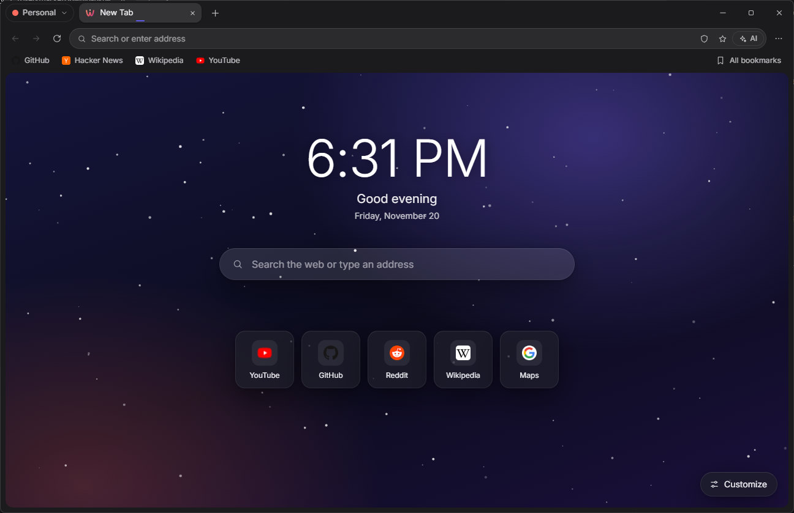
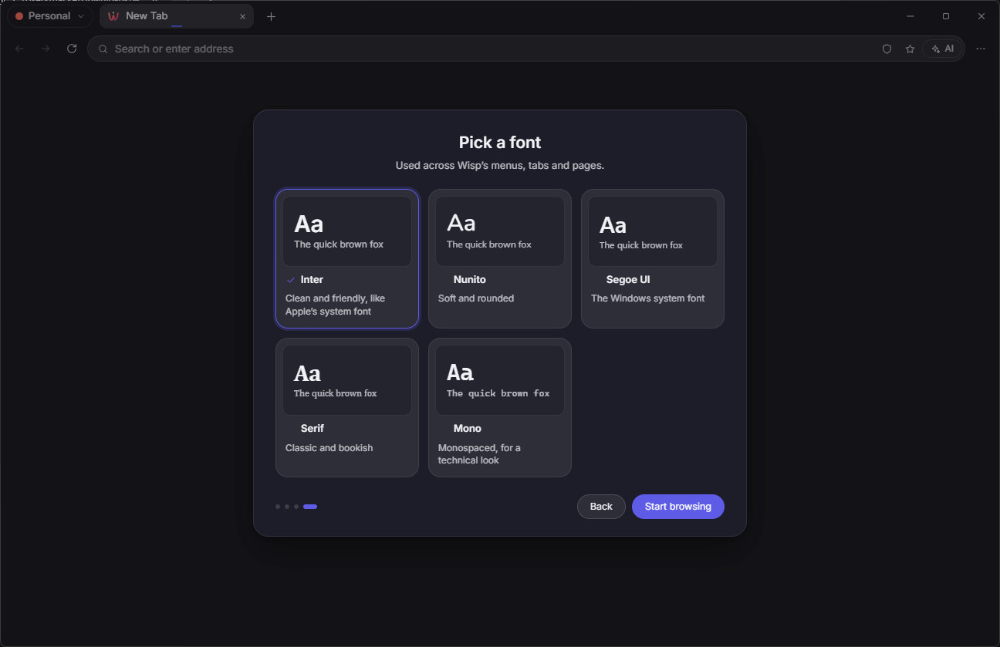

  

<h1 align="center">Wisp</h1>

  A light, glassy browser for Windows and iPhone. Built in Rust on the system web engine (WebView2 on
  Windows, WebKit on iOS), so there is no bundled Chromium and no Electron.

  <a href="https://jakedev2.github.io/Wisp/"><b>Website</b></a> ·
  <a href="https://github.com/jakedev2/Wisp/releases/latest"><b>Download</b></a> ·
  <a href="https://discord.gg/4rn5e7JTTN">Discord</a> ·
  <a href="https://jakedev2.github.io/Wisp/privacy.html">Privacy</a>

  
  

  
  

## Features

- **Glass interface**: frosted surfaces on the Windows 11 Mica backdrop (or a solid Flat style), three layouts
  (Classic, Compact, Vertical), smooth animations that respect reduce-motion, light and dark themes, true full screen, choice of interface font.
- **Tabs**: horizontal or vertical (collapsible sidebar), drag to reorder, pinned tabs, mute, duplicate,
  session restore, and a Memory saver that unloads background tabs so 15+ open tabs stay around 150–250 MB.
- **Spaces**: named, colour-coded workspaces, each with its own tabs, pins, wallpaper and cookie profile (`Alt+1…9`).
- **Split screen**: 2 to 4 panes. Drag a tab to an edge; drag the gaps to resize.
- **Omnibox and command palette**: search prefixes (`d cats`, `g rust`, `k …`), suggestions, `Ctrl+K` for everything.
- **New tab page**: wallpapers (gallery, upload image/video/GIF, gradients), animated starfield or particles,
  draggable widgets (clock, search, speed dial, weather, notes, recent tabs), accent colour, glass intensity.
- **AI sidebar** (`Ctrl+Shift+Space`): Gemini, Groq and OpenRouter with your own free key (stored in the Windows
  Credential Manager), local **Ollama**, or the Claude / ChatGPT / Gemini web apps. Summarize or ask about the
  page, translate, chat with all open tabs, or right-click selected text.
- **Privacy**: ad and tracker blocker (Rust filter-list engine, per-site switch), HTTPS-only mode,
  private windows, clear-data controls.
- **Everyday tools**: bookmarks, history, downloads, find in page, per-site zoom, reader mode,
  picture-in-picture, import bookmarks from Chrome, Edge, Brave and Firefox, rebindable shortcuts.
- **Updates**: checks GitHub Releases in the background, verifies a SHA-256, installs on restart, and rolls back
  automatically if a new version keeps failing to start.

## Install

1. Download `Wisp-<version>-setup.exe` from the [latest release](https://github.com/jakedev2/Wisp/releases/latest).
2. Run it. It installs just for you (no administrator rights) into `%LOCALAPPDATA%\Programs\Wisp`, adds a Start Menu
   shortcut, and offers a Desktop shortcut, default-browser setup, and Ollama for local AI.
3. Windows 10 may need the [WebView2 Runtime](https://developer.microsoft.com/microsoft-edge/webview2/). Windows 11 already has it.

Silent install: `Wisp-<version>-setup.exe /S` (add `/NODESKTOP`, `/DEFAULTBROWSER`, `/OLLAMA` as needed).

**Default browser:** Windows does not let programs set this silently. Setup registers Wisp so it shows up in
*Settings → Apps → Default apps*, and opens that page when you tick the option.

**Uninstall:** *Settings → Apps → Installed apps → Wisp*. It removes the app, shortcuts, registry entries and
the default-browser registration, and asks whether to also delete your data (bookmarks, history, profiles).
The default is to keep it. Silent: `"%LOCALAPPDATA%\Programs\Wisp\Uninstall.exe" /S [/DELETEDATA]`.

**Portable:** the `Wisp-<version>-windows-x64.exe` file on each release is the whole app. It is also what auto-update downloads.

Your data lives in `%APPDATA%\Wisp`.

## iPhone and iPad (early preview)

[`ios/`](ios/) holds Wisp for iOS: a native Rust app on the system's WebKit engine with a glass bottom bar,
tab grid and content blocker. See [ios/README.md](ios/README.md) for what's in it and how to install it on
your phone from Windows.

## Keyboard shortcuts

Wisp uses Chrome's shortcuts, and everything is rebindable in *Settings → Shortcuts*. Highlights:

| Keys | Action |
|---|---|
| `Ctrl+T` / `Ctrl+W` / `Ctrl+Shift+T` | New tab / close tab / reopen closed tab |
| `Ctrl+Tab`, `Ctrl+PgDn` / `Ctrl+Shift+Tab`, `Ctrl+PgUp` | Next / previous tab |
| `Ctrl+1…8` / `Ctrl+9` | Go to that tab / the last tab |
| `Ctrl+L`, `Alt+D`, `F6` | Address bar (`Ctrl+Enter` adds www. and .com) |
| `Alt+←` / `Alt+→` / `Alt+Home` | Back / forward / New Tab page |
| `Ctrl+R`, `F5` / `Ctrl+Shift+R`, `Shift+F5` | Reload / reload ignoring the cache |
| `Ctrl+D` / `Ctrl+Shift+D` / `Ctrl+Shift+B` | Bookmark page / bookmark all tabs / bookmarks bar |
| `Ctrl+H` / `Ctrl+J` / `Ctrl+Shift+O` | History / downloads / bookmarks |
| `Ctrl+F`, `F3`, `Ctrl+G` | Find in page, next match |
| `Ctrl+P` / `Ctrl+U` / `F12` | Print / view source / developer tools |
| `Ctrl+Shift+N` / `Ctrl+Shift+Delete` / `Alt+F` | Private window / clear browsing data / menu |
| `Ctrl+K` | Command palette and tab search (Wisp) |
| `Ctrl+Shift+Space` | Wisp AI |
| `F9` | Reader mode |
| `Alt+1…9` | Spaces |

## Built in Rust 🦀

Wisp is written entirely in [Rust](https://www.rust-lang.org): about 9,000 lines for the Windows app, plus the iOS app in
[`ios/`](ios/). Instead of shipping its own copy of Chromium, it drives the web engine the system already has. That keeps
the download around 2 MB and memory use low.

| Piece | What it uses |
|---|---|
| Windows and events | [`tao`](https://crates.io/crates/tao) for native windows and the event loop |
| Web views | [`wry`](https://crates.io/crates/wry) and [`webview2-com`](https://crates.io/crates/webview2-com) on Microsoft Edge WebView2 |
| Windows integration | the official [`windows`](https://crates.io/crates/windows) crate: Mica backdrop, Windows Hello, DPAPI encryption, the registry |
| iPhone and iPad | [`objc2`](https://crates.io/crates/objc2) bindings to UIKit and WebKit, with no Swift or Objective-C code |
| Ad and tracker blocker | Wisp's own filter-list engine (Adblock Plus syntax, network and cosmetic rules) in `src/blocker.rs` |
| Passwords | AES-256-GCM via [`aes-gcm`](https://crates.io/crates/aes-gcm), stored encrypted with Windows DPAPI |
| History, bookmarks and imports | SQLite via [`rusqlite`](https://crates.io/crates/rusqlite) |
| Chrome extensions | CRX3 parsing and unpacking with [`zip`](https://crates.io/crates/zip), loaded through WebView2's extension API |
| Updates | [`ureq`](https://crates.io/crates/ureq) for HTTPS and [`sha2`](https://crates.io/crates/sha2) to verify each download |
| AI keys | [`keyring`](https://crates.io/crates/keyring), which keeps them in Windows Credential Manager |

The interface (tab strip, menus, settings, New Tab page) is plain HTML, CSS and JavaScript in [`ui/`](ui/), compiled into the
executable. Rust handles everything underneath: tabs, profiles, storage, the blocker, downloads, updates and security.

## How updates stay safe

- Updates come only from this repository's GitHub Releases, over HTTPS.
- The downloaded file's SHA-256 must match the value in the release's `latest.json`, and is checked again right before it is applied.
- Updates install on restart; nothing is ever swapped while you work.
- A new version has to stay running for 20 seconds. If it fails to do that three launches in a row, the previous version is restored.

## License

[MIT](LICENSE)
