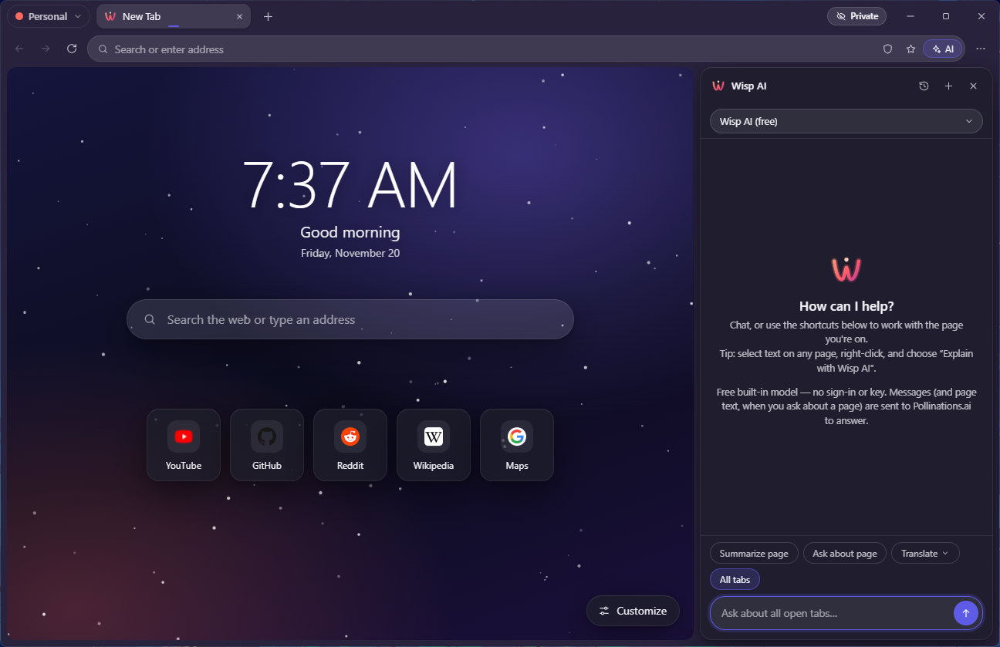
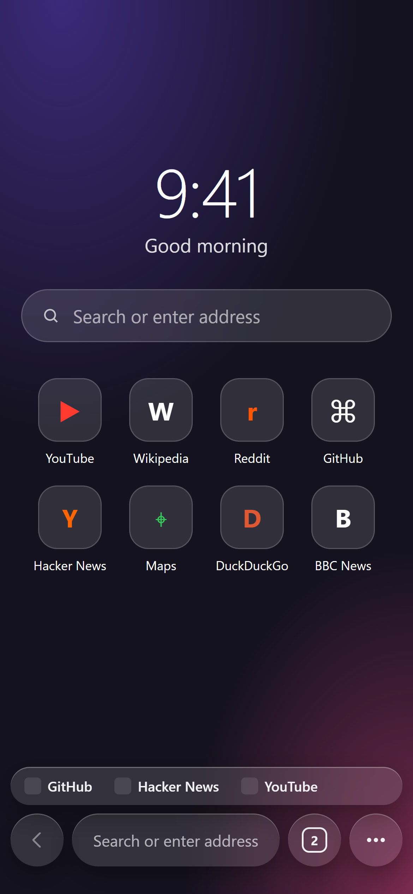

<p align="center">
  
</p>

<h1 align="center">Wisp</h1>

<p align="center">
  A light, glassy browser for Windows and iPhone. Built in Rust on the system web engine (WebView2 on
  Windows, WebKit on iOS), so there is no bundled Chromium and no Electron.
</p>

<p align="center">
  <a href="https://jakedev2.github.io/Wisp/"><b>Website</b></a> ·
  <a href="https://github.com/jakedev2/Wisp/releases/latest"><b>Download</b></a> ·
  <a href="https://jakedev2.github.io/Wisp/privacy.html">Privacy</a>
</p>

<p align="center">
  
  
</p>
<p align="center">
  
  
</p>

## Features

- **Glass interface**: frosted surfaces on the Windows 11 Mica backdrop (or a solid Flat style), three layouts
  (Classic, Compact, Vertical), smooth animations that respect reduce-motion, light and dark themes, true full screen, choice of interface font.
- **Tabs**: horizontal or vertical (collapsible sidebar), drag to reorder, pinned tabs, mute, duplicate,
  session restore, and a Memory saver that unloads background tabs so 15+ open tabs stay around 150–250 MB.
- **Spaces**: named, colour-coded workspaces, each with its own tabs, pins, wallpaper and cookie profile (`Alt+1…9`).
- **Split screen**: 2 to 4 panes. Drag a tab to an edge; drag the gaps to resize.
- **Omnibox and command palette**: search prefixes (`d cats`, `g rust`, `k …`), suggestions, `Ctrl+K` for everything.
- **New tab page**: wallpapers (gallery, upload image/video/GIF, gradients), animated starfield or particles,
  draggable widgets (clock, search, speed dial, weather, notes, recent tabs), accent colour, glass intensity.
- **AI sidebar** (`Ctrl+J`): Gemini, Groq and OpenRouter with your own free key (stored in the Windows
  Credential Manager), local **Ollama**, or the Claude / ChatGPT / Gemini web apps. Summarize or ask about the
  page, translate, chat with all open tabs, or right-click selected text.
- **Privacy**: ad and tracker blocker (Rust filter-list engine, per-site switch), HTTPS-only mode,
  private windows, clear-data controls.
- **Everyday tools**: bookmarks, history, downloads, find in page, per-site zoom, reader mode,
  picture-in-picture, import bookmarks from Chrome, Edge, Brave and Firefox, rebindable shortcuts.
- **Updates**: checks GitHub Releases in the background, verifies a SHA-256, installs on restart, and rolls back
  automatically if a new version keeps failing to start.

## Install

1. Download `Wisp-<version>-setup.exe` from the [latest release](https://github.com/jakedev2/Wisp/releases/latest).
2. Run it. It installs just for you (no administrator rights) into `%LOCALAPPDATA%\Programs\Wisp`, adds a Start Menu
   shortcut, and offers a Desktop shortcut, default-browser setup, and Ollama for local AI.
3. Windows 10 may need the [WebView2 Runtime](https://developer.microsoft.com/microsoft-edge/webview2/). Windows 11 already has it.

Silent install: `Wisp-<version>-setup.exe /S` (add `/NODESKTOP`, `/DEFAULTBROWSER`, `/OLLAMA` as needed).

**Default browser:** Windows does not let programs set this silently. Setup registers Wisp so it shows up in
*Settings → Apps → Default apps*, and opens that page when you tick the option.

**Uninstall:** *Settings → Apps → Installed apps → Wisp*. It removes the app, shortcuts, registry entries and
the default-browser registration, and asks whether to also delete your data (bookmarks, history, profiles).
The default is to keep it. Silent: `"%LOCALAPPDATA%\Programs\Wisp\Uninstall.exe" /S [/DELETEDATA]`.

**Portable:** the `Wisp-<version>-windows-x64.exe` file on each release is the whole app. It is also what auto-update downloads.

Your data lives in `%APPDATA%\Wisp`.

## iPhone and iPad (early preview)

[`ios/`](ios/) holds Wisp for iOS: a native Rust app on the system's WebKit engine with a glass bottom bar,
tab grid and content blocker. See [ios/README.md](ios/README.md) for what's in it and how to install it on
your phone from Windows.

## Keyboard shortcuts

Everything is rebindable in *Settings → Shortcuts*. Defaults: `Ctrl+T` new tab, `Ctrl+W` close, `Ctrl+L` address bar,
`Ctrl+K` palette, `Ctrl+J` AI, `Ctrl+F` find, `Ctrl+D` bookmark, `Ctrl+H` history, `Ctrl+Shift+J` downloads,
`Ctrl+,` settings, `Ctrl+Shift+N` private window, `F11` full screen, `Alt+1…9` spaces.

## Build from source

You need Windows, [Rust](https://rustup.rs) (MSVC toolchain) and the "Desktop development with C++" build tools.

```
git clone https://github.com/jakedev2/Wisp
cd Wisp
cargo run --release
```

Checks (the same ones CI runs):

```
cargo fmt --all -- --check
cargo clippy --all-targets -- -D warnings
cargo test
```

Build the installer (needs [NSIS](https://nsis.sourceforge.io)):

```
cargo build --release
mkdir dist
makensis -DVERSION=0.1.0 -DEXE_PATH=%CD%\target\release\Wisp.exe -DOUT_FILE=%CD%\dist\Wisp-0.1.0-setup.exe installer\wisp.nsi
```

The version is defined once, in `Cargo.toml`. The repository owner and name used for updates are
`GITHUB_OWNER` and `GITHUB_REPO` in `src/main.rs`.

## Releasing

Releases are built by `.github/workflows/release.yml` when you push a tag.

### First release

```
git init
git add .
git commit -m "Initial commit"
git branch -M main
git remote add origin https://github.com/jakedev2/Wisp.git
git push -u origin main

git tag v0.1.0
git push origin v0.1.0
```

Wait for the **Release** workflow to finish (Actions tab). The release will contain the installer
(`Wisp-0.1.0-setup.exe`), the portable build (`Wisp-0.1.0-windows-x64.exe`), `SHA256SUMS.txt` and
`latest.json` (the update feed). Install `0.1.0` from the release.

### Check that updates work

1. Bump `version` in `Cargo.toml` to `0.1.1` (and add a line to `CHANGELOG.md`). Commit and push.
2. `git tag v0.1.1` then `git push origin v0.1.1`.
3. Open the installed `0.1.0`. In *Settings → Updates* press **Check now** (it also checks by itself about a minute after
   launch, then every 6 hours). It downloads in the background and shows **Update 0.1.1 ready → Restart**.
4. Restart. Wisp swaps in the new version and relaunches. *Settings → Updates* now shows `0.1.1`. The old version is kept
   as `Wisp.exe.prev` next to it.

For a beta channel, tag `v0.2.0-beta.1`. Tags with a `-` are marked as pre-releases and only reach people who chose
the **Beta** channel in *Settings → Updates*.

### Code signing (optional)

Unsigned builds work but Windows SmartScreen may warn. To sign the app and installer, add two repository secrets
(*Settings → Secrets and variables → Actions*):

| Secret | Value |
| --- | --- |
| `WINDOWS_CERT_BASE64` | your code-signing certificate (`.pfx`) encoded as base64 |
| `WINDOWS_CERT_PASSWORD` | the password for that certificate |

Create the base64 text in PowerShell: `[Convert]::ToBase64String([IO.File]::ReadAllBytes("cert.pfx")) | Set-Clipboard`

When the secrets exist the release workflow signs `Wisp.exe` and the installer with SHA-256 and a timestamp.
When they don't, those steps are skipped.

## How updates stay safe

- Updates come only from your repository's GitHub Releases, over HTTPS.
- The downloaded file's SHA-256 must match the value in the release's `latest.json`, and is checked again right before it is applied.
- Updates install on restart; nothing is ever swapped while you work.
- A new version has to stay running for 20 seconds. If it fails to do that three launches in a row, the previous version is restored.

## License

[MIT](LICENSE)
